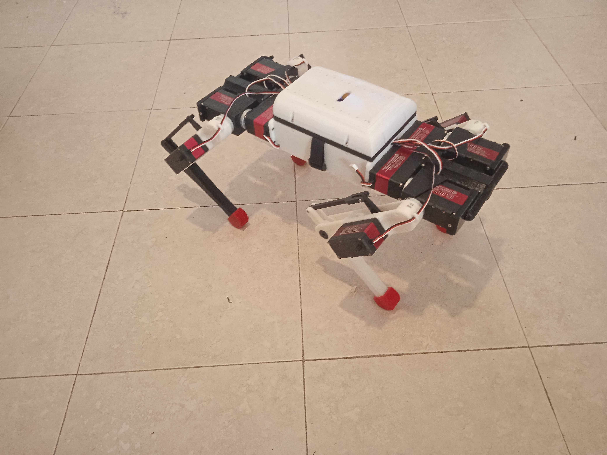
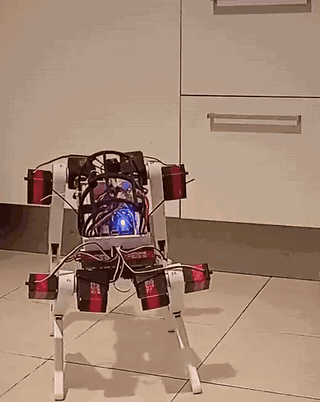
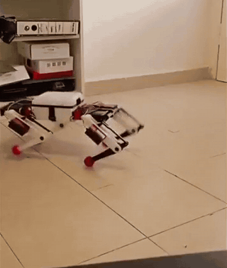
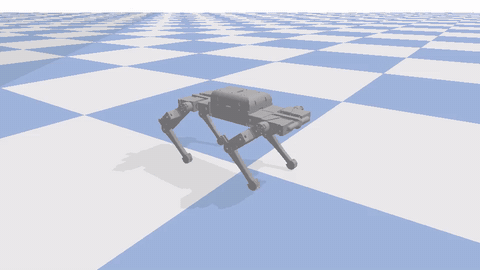

# ASEEL
<p align="center">
  
</p>

ASEEL is a low-cost 12-DoF quadruped robot that I designed and built from scratch in 2020: mechanics, electronics and software.

## Hardware

- 12 × RDS5160 270° servos (3 per leg)
- Raspberry Pi 3 or higher with a RedBoard+ servo controller
- 2S 5000 mAh LiPo batteries
- Mechanical parts are 3D printed

Full parts list: [BOM.csv](BOM.csv)

## Design iterations

The legs went through three designs, all shaped by the limited torque of hobby servos:

1. **v0:** servos mounted directly in the knees, and about twice the size of the final robot. The leg inertia was too high and the robot was too big for the servos' torque.
2. **v1:** scaled down, with the knee actuator moved up to the hip to reduce leg inertia, driving the knee through a belt and pulley. The belt was too elastic, which made the legs wobble, especially on fast moves.
3. **v2 (final):** the belt replaced with a linkage, which made the leg structure far more rigid.

| v1: belt and pulley | v2: linkage (final) |
|:---:|:---:|
|  |  |

## Software

- `Code/ASEEL_Robot_Code.py` runs on the Raspberry Pi: servo drivers with a calibration offset per servo, inverse kinematics per leg, and a scripted trot gait, controlled from the keyboard.
- `Code/ASEEL_Simulation_Code.py` runs the same inverse kinematics and gait in PyBullet on the robot's URDF. I used it as a safety check before running new motions on the physical robot, to make sure the legs only make safe moves.

<p align="center">
  
</p>
- `URDF/` is the robot model, exported from my CAD assembly to URDF. The ROS package files in this folder (`package.xml`, `CMakeLists.txt`, launch files) were generated by the exporter and are not used.

## Running the simulation

```
pip install pybullet numpy scipy
python Code/ASEEL_Simulation_Code.py
```

Click the PyBullet window, then:

| Key | Action |
|---|---|
| `h` | Home position |
| Up / Down arrow | Walk forward / backward |
| Left / Right arrow | Walk left / right |
| Page Up / Home | Rotate right / left |

## Running on the robot

`Code/ASEEL_Robot_Code.py` needs the `redboard`, `getch` and `adxl345` Python libraries plus `numpy` and `scipy`. Keys: `h` home, `w`/`s` forward/backward, `a`/`d` left/right, `q`/`e` rotate left/right.

## Limitations

- The gait is scripted and open-loop: hobby servos give no joint feedback.
- Code for reading the ADXL345 accelerometer is included but not used by the gait.
- The simulation uses ideal position-controlled joints, without the backlash and servo-to-servo variation of the real robot. It checks that motions stay in a safe range; it is not a digital twin.
